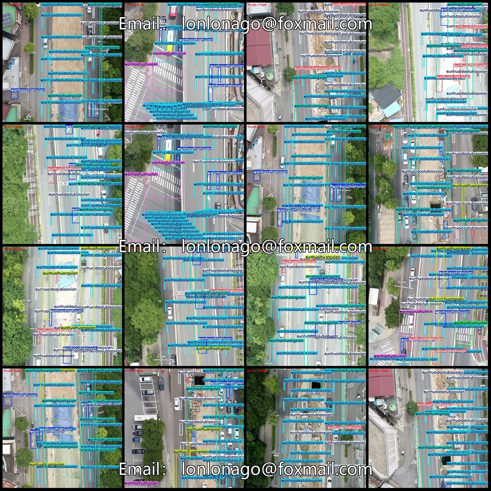
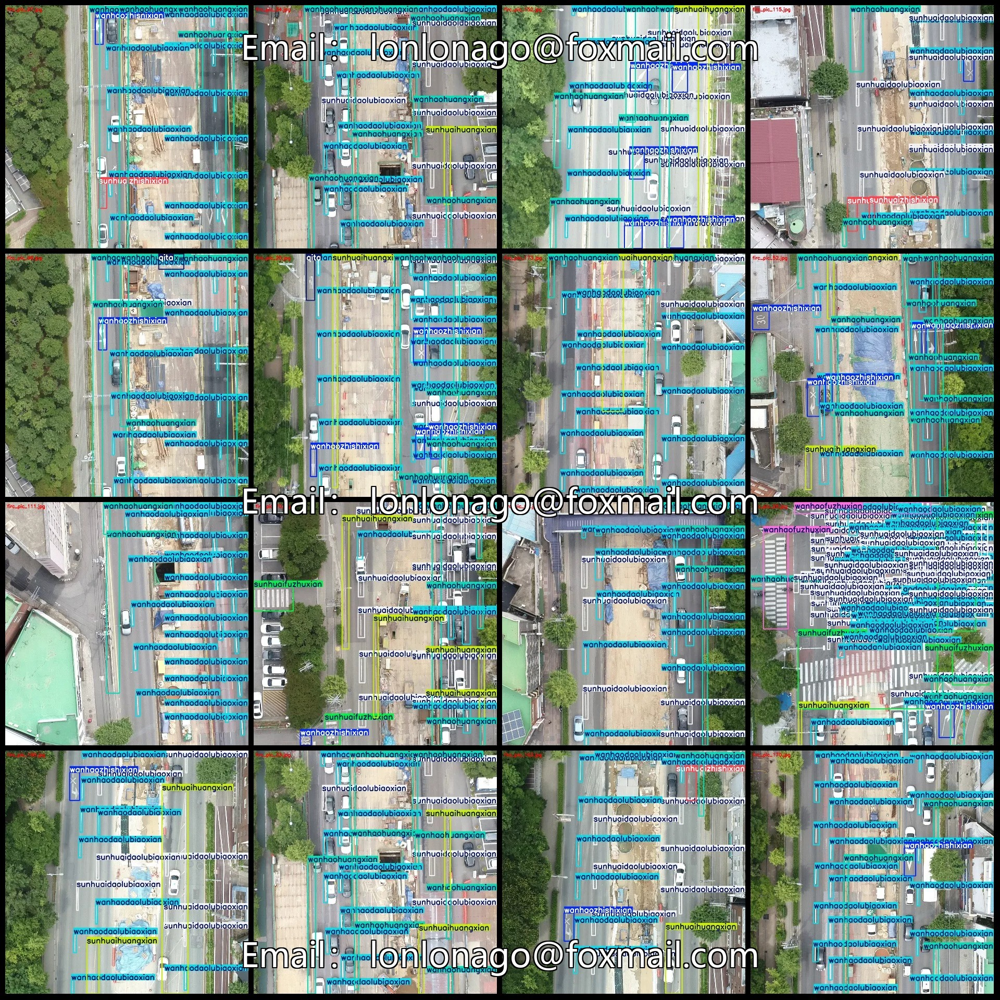
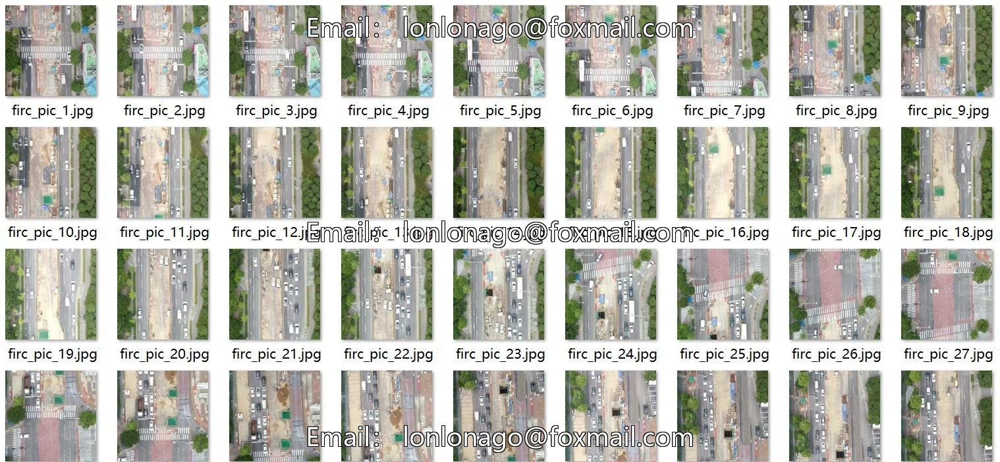
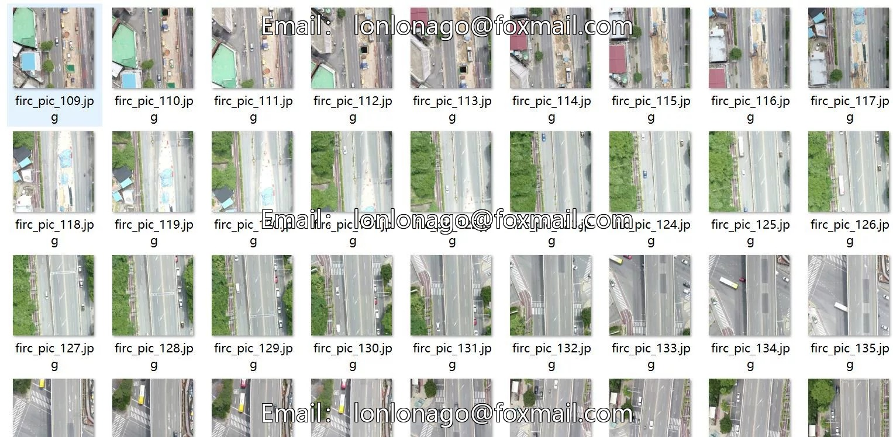

# Drone-view aerial photography road surface marking damage assessment detection dataset VOC+YOLO

## Body

Drone-view aerial photography road surface marking damage assessment detection dataset VOC+YOLO format with 175 images in 9 categories
Warm Reminder: Due to the dataset's replicability, please confirm compliance before purchasing.
Dataset format: Pascal VOC format + YOLO format (txt file without split path, only containing jpg images and corresponding VOC format xml files and yolo format txt files)
Number of images (number of jpg files): 175
Number of annotations (number of xml files): 175
Number of annotations (number of txt files): 175
Number of annotation categories: 9

Label category names (Note that the order of labels in the YOLO format does not correspond to this, but is based on the classes.txt file in the labels folder): ["qita", "sunhuaidaolubiaoxian", "sunhuaifuzhuxian", "sunhuaihuangxian", "sunhuaizhishixian", "wanhaodaolubiaoxian", "wanhaofuzhuxian", "wanhaohuangxian", "wanhaozhishixian"]

1. Category: ["Other", "Damaged Road Markings", "Damaged Guiding Lines", "Damaged Yellow Lines", "Damaged Indicating Lines", "Undamaged Road Markings", "Undamaged Guiding Lines", "Undamaged Yellow Lines", "Undamaged Indicating Lines"]
2. Box Count for Each Category
qita Frames = 47
sunhuaidaolubiaoxian Frames = 1116
sunhuaifuzhuxian Frames = 70
sunhuaihuangxian Frames = 243
sunhuaizhishixian Frames = 104
wanhaodaolubiaoxian Frames = 2634

wanhaofuzhuxian Frames = 76
wanhaohuangxian Frames = 633
wanhaozhishixian Frames = 349
Total Frames: 5272
Number of Images per Classification
Other Images = 31
Sunhuaidaolubiaoxian Images = 154
Sunhuaifuzhuxian Images = 39
Sunhuaihuangxian Images = 109
Sunhuaizhishixian Images = 62

wanhaodaolubiaoxian occupies = 175
wanhaofuzhuxian occupies = 48
wanhaohuangxian occupies = 159
wanhaozhishixian occupies = 138
Image resolution: 1280x1280
Labeling tool: labelImg
Labeling rules: Draw a rectangle around the category.
Important note: The dataset does not have separate training, validation, and test sets; you need to partition them yourself.
Special statement: This dataset does not guarantee the accuracy of the trained models or weight files.

## Images

## Payment

Here is a pay link on Stripe ( https://buy.stripe.com/3cs8yP7sY87d0vu9AB ). Please contact me lonlonago@foxmail.com after funding $89, and I will send you a complete data files , thank you!

